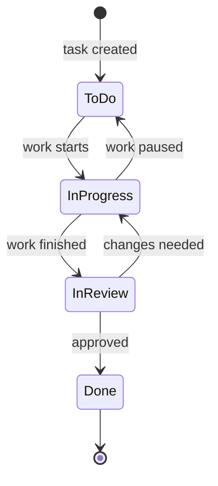

# Process flow — task lifecycle

## States

| State | Meaning |
|-------|---------|
| To Do | Created, not started |
| In Progress | Someone is working on it |
| In Review | Work is done, waiting for a check |
| Done | Checked and finished |

## Transition rules

- A task is created in **To Do**.
- Only the assignee (or an admin) moves a task forward.
- **In Review → In Progress** happens when the reviewer asks for changes.
- **In Progress → To Do** happens when work is paused and the task goes
  back to the pile.
- **Done** is final — a finished task is never reopened; a follow-up is a
  new task.
- Every transition writes one row to `task_status_history`
  (task, old status, new status, who changed it, when).

## Role-based access

| Action | Admin | Member |
|--------|-------|--------|
| Create project | Yes | No |
| Create task | Yes | No |
| Assign / reassign task | Yes | No |
| Update status of own task | Yes | Yes |
| Update status of someone else's task | Yes | No |
| View dashboard | Yes | Yes |

## AI priority

After the status rules, `ai/prioritize.py` runs over every open task:

1. It reads the task, its due date, and how many open tasks the assignee
   already has.
2. Gemini suggests a priority (High / Medium / Low) with a one-line reason.
3. If the API call fails, the rule-based scorer decides instead:
   overdue → High, due within 2 days → High, due within 7 days → Medium,
   otherwise Low. The reason notes it when the assignee already has
   4+ open tasks.
4. The result is written to `tasks.ai_priority` and `tasks.ai_reason`, which
   the Power BI dashboard reads.
